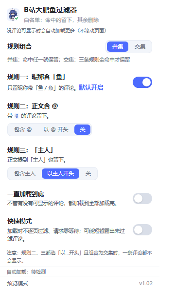
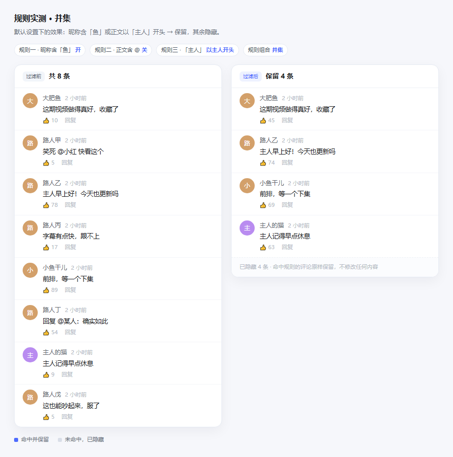

# B站大肥鱼过滤器

**——让你的 B站评论区充满卖萌的大肥鱼！**

  

给 B 站评论区做**白名单过滤**的小工具：命中的评论留下，不命中的隐藏。

不看广告、不举报、不拉黑，只决定**你自己的浏览器**里显示哪些评论。扩展与油猴脚本共用同一套规则和同一个设置面板。



## 三条规则

| 规则 | 默认 | 保留条件 | 例子 |
| --- | --- | --- | --- |
| 规则一 · 昵称含「鱼」 | **开** | 作者昵称里出现 `鱼` 或 `魚` | `大肥鱼`、`小鱼干儿`、`鱻魚` |
| 规则二 · 正文含 @ | **关** | 三挡：包含 `@` ／ 以 `@` 开头 ／ 关 | 包含档：`笑死 @小红`；开头档：`@小红 快看` |
| 规则三 · 「主人」 | **以主人开头** | 三挡：包含「主人」／ 以「主人」开头 ／ 关 | `主人早上好`、`今天主人不在`（包含档） |

⚠️ 这是白名单：**只留命中的，其余全部隐藏**。默认只开规则一，页面上就只剩昵称带鱼的评论。

## 三条规则怎么组合

设置面板最上方的「规则组合」决定多条规则同时命中时怎么算：

| 组合 | 判定 | 什么时候用 |
| --- | --- | --- |
| **并集**（默认） | 命中任意一条就保留 | 想尽量多看一点 |
| 交集 | 全部规则都命中才保留 | 只要最严格的那批 |

规则全部关掉时不做任何过滤。

> 小提醒：交集 + 规则二「以 @ 开头」+ 规则三「以主人开头」会得到空集——没有评论既能以 `@` 开头又能以「主人」开头。这时页面上一条评论都不会显示，属预期行为。

## 实际效果



## 安装

### Chrome / Edge 扩展

1. 下载 [`bilibili-fish-filter-v1.02.zip`](https://github.com/deepseekmaid/bilibili-fish-filter/releases/latest) 并解压；
2. 打开 `chrome://extensions`（Edge 为 `edge://extensions`），右上角开启「开发者模式」；
3. 点「加载已解压的扩展程序」，选择解压出来的 `bilibili-fish-filter/` 目录；
4. 刷新已打开的 B 站页面。

也可以在 `git clone` 之后直接加载仓库根目录。

### Tampermonkey / Violentmonkey 油猴脚本

1. 安装 [Tampermonkey](https://www.tampermonkey.net/)；
2. 打开 [`bilibili-fish-filter.user.js`](https://github.com/deepseekmaid/bilibili-fish-filter/raw/main/dist/bilibili-fish-filter.user.js)，脚本管理器会弹出安装页；
3. 刷新 B 站页面，右下角出现蓝色圆形按钮，点开就是设置面板。

## 使用

- 设置面板与扩展弹窗是**同一份 UI**：点工具栏图标（扩展）或右下角按钮（油猴）打开；
- 任何开关都即时生效，**不需要刷新页面**；关闭规则后，之前隐藏的评论会按原样还原；
- 面板底部显示当前页「保留 N 条 / 共 M 条」，可以当作过滤是否生效的判据。

**主评论被隐藏时整楼一起收起**：B 站的「共 N 条回复」折叠条和分割线住在楼层容器里，只藏评论会留下一排空白，所以命中删除时会连楼层容器一起收起——代价是这楼下面的楼中楼不会再展开。

## 自动加载

白名单过滤后经常出现「整页评论都被隐藏」，看起来像评论区空了。所以做了自动加载：

- **默认**：一直往下加载，直到出现第一条能显示的评论就停；
- **一直加载到底**：不管有没有可显示的评论，都把评论区加载完；
- **快速模式**：加载期间不逐页过滤、请求之间零等待，加载完再一次性过滤。代价是过程中可能短暂看到未过滤的评论。

三种模式都**不会滚动页面**，也不会改变你的滚动位置。

## 隐私

- 不发送任何网络请求，没有远程配置、没有统计上报；
- 扩展只用 `storage` 一个权限；油猴版只写入 `GM_setValue` 本地存储；
- 仅在 `www.bilibili.com`、`t.bilibili.com`、`space.bilibili.com`、`live.bilibili.com` 生效；
- 隐藏只改当前页面 DOM，不删除、不举报、不修改任何服务端数据。

## 已知限制

- 评论区 DOM 由 B 站前端渲染，改版后选择器可能需要跟着调整；
- 只处理网页版评论区，不涉及 App；
- 主评论被隐藏时，该楼下的楼中楼也不会再展开（见上文）。

## 开发

需要 Node.js >= 20。

```bash
npm install
npm test               # 46 项断言：扩展 37 + 后挂载 1 + 面板 3 + 油猴 5（跑前自动重建油猴脚本）
npm run build          # 生成 dist/ 下的 zip 与 .user.js
npm run version:check  # 校验 manifest / package / 油猴 @version 三处一致
```

**版本号只改一处**：`manifest.json` 里的 `version`。构建时油猴脚本的 `@version` 会自动跟随，`version:check` 与 CI 会拦住不一致。

### 目录结构

```
├── manifest.json                 MV3 清单
├── content.js                    过滤逻辑（扩展与油猴共用）
├── popup.html / popup.js         设置面板（油猴版直接复用）
├── icons/                        16 / 32 / 48 / 128 图标
├── dist/                         构建产物：zip + .user.js
├── docs/                         README 截图
├── scripts/
│   ├── build.mjs                 零依赖打 zip
│   ├── build-userscript.mjs      由 content.js 生成油猴脚本
│   ├── check-version.mjs         版本一致性校验
│   └── userscript/tail.js        油猴适配层（GM 存储 + 面板挂载）
├── test/filter.test.mjs          扩展侧断言
├── test/late-shadow.test.mjs     评论区后挂 shadowRoot 的回归
├── test/popup.test.mjs           面板初始状态断言
├── test/userscript.test.mjs      油猴侧断言
└── .github/workflows/ci.yml      测试 → 构建 → 版本校验
```

## 版本命名

发布名是 **v1.01**，但 `manifest.json` 里写的是 `"version": "1.0.1"`：Chrome 规定版本号「非零整数不能以 0 开头」，`1.01` 会被判非法、扩展直接加载失败。所以内部用合法写法，再用 `"version_name": "v1.01"` 让扩展页和弹窗显示 **v1.01**；GitHub 的 tag 与 Release 也用 `v1.01`。

## 许可

[MIT](LICENSE)